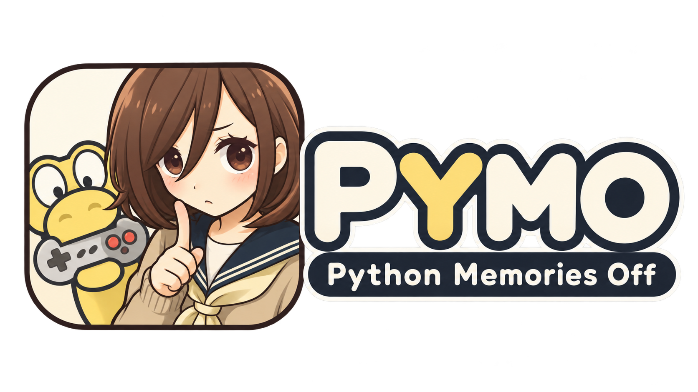

<p align="center">
  
</p>

# CPyMO for Nintendo DS

**在 Nintendo DS / DS Lite / DSi 上体验 PyMO 视觉小说。**

CPyMO for NDS 是基于 [CPyMO](https://github.com/Strrationalism/CPyMO)
的 Nintendo DS 系列移植版本。一个 `.nds` 可从游戏资料库启动多个 PyMO 游戏；
配套转换助手支持 S60v3、S60v5 与 Android PyMO 游戏数据。

**最新版本：** [CPyMO for NDS 1.3.0](https://github.com/Blueteemo/CPyMO/releases/tag/nds-v1.3.0)（已正式发布）。

## 下载与开始使用

> Windows、macOS ARM64、通用 NDS 程序、完整源码及 SHA-256 校验清单均已在正式发行页提供。

| 用途 | 发行文件 |
|---|---|
| 已转换过游戏，只更新引擎 | [cpymo-nds.nds](https://github.com/Blueteemo/CPyMO/releases/download/nds-v1.3.0/cpymo-nds.nds) |
| 首次使用、转换游戏、添加视频 | [Windows Starter](https://github.com/Blueteemo/CPyMO/releases/download/nds-v1.3.0/CPyMO-for-NDS-1.3.0-Starter-Windows.zip) / [macOS ARM64 Starter](https://github.com/Blueteemo/CPyMO/releases/download/nds-v1.3.0/CPyMO-for-NDS-1.3.0-Starter-macOS-arm64.zip)；不提供 Intel Mac 预编译版 |
| 查看全部变更与校验 | [发行说明](https://github.com/Blueteemo/CPyMO/releases/tag/nds-v1.3.0) · [完整源码](https://github.com/Blueteemo/CPyMO/releases/download/nds-v1.3.0/CPyMO-for-NDS-1.3.0-Sources.zip) · [SHA256SUMS](https://github.com/Blueteemo/CPyMO/releases/download/nds-v1.3.0/CPyMO-for-NDS-1.3.0-SHA256SUMS.txt) |

转换助手在电脑上运行，游戏程序在 DS / DSi 上运行。**发行包不附任何游戏或用户存档。**

## 1.3.0 更新

- **16 色主题**：默认配色、自动跟随主机设置，以及原版 NDS 的 16 种固件主题色。
- **游戏库与双屏交互**：支持 START 启动，完善资料库脚注、辅助屏指引与重新开始后的标题阶段提示。
- **高亮与音频**：修正标题菜单高亮混合取整，音频采用约 +1.5 dB 的保守目标增益并保留峰值保护。
- **NDS 程序及配套转换器图标焕新**：NDS 使用完整方形构图与暖灰棕细边框，加载图更清楚；Mac 转换器改善图标显示比例。
- **桌面界面维护**：补回此前 1.2 维护版已有的进度条空闲隐藏、游戏版本列表按数量调整及视频选项宽度自适应。版本号保持 1.3.0，NDS ROM 不变。

继续保留 DSi/TWL 模式、三态增强双屏、NVL1/NVA1 视频、多游戏资料库和四语界面。完整变化见 [1.3.0 发行说明](https://github.com/Blueteemo/CPyMO/releases/tag/nds-v1.3.0)。

## 安装

1. 在 Windows 或 Apple Silicon macOS 转换助手中选择自己的 PyMO 游戏 ZIP 或包含 `gameconfig.txt` 的游戏文件夹，使用推荐默认选项转换。
2. 将转换结果的 `cpymo-nds.nds` 和 `pymo/` 文件夹复制到 TF 卡根目录。
3. 保留已有烧录卡内核、游戏和存档。安装同名游戏前先备份 `save/`，**不要用新转换结果的空存档目录覆盖旧存档**。
4. 在掌机启动 `cpymo-nds.nds`，从游戏列表选择游戏。

```text
TF 卡根目录/
├── cpymo-nds.nds
└── pymo/
    └── games/
        └── 游戏目录/
            ├── gameconfig.txt
            ├── script/
            ├── nds-cache/
            └── save/
```

已有可运行的 1.2.0 缓存与存档可以继续保留，通常只需更新 `.nds`；如需为旧游戏添加视频，应从合法持有的原游戏数据转换到新目录，并保留旧存档。

## 操作

| 输入 | 作用 |
|---|---|
| A、轻触 | 确认、继续；游戏库轻触两次可启动选中游戏 |
| X | 游戏正文打开引擎菜单；游戏列表中可切换界面语言 |
| B | 返回／取消；视频播放时跳过 |
| L | 上屏游戏 → 下屏游戏 → 增强双屏 |
| Y | 游戏中隐藏或唤回辅助屏；资料库打开主题设置 |
| R | 根据游戏设置快进 |
| START | 资料库启动选中游戏；游戏正文快速保存到标准存档 1，会覆盖该存档 |
| SELECT | 游戏正文快速读取标准存档 1；资料库刷新列表 |
| 合盖 / 开盖 | 暂停与静音／恢复 |

## 兼容性、转换器和开发文档

- [NDS 后端、安装与兼容边界](https://github.com/Blueteemo/CPyMO/blob/nds-v1.3.0/cpymo-backends/nds/README.md)
- [转换助手：简体中文 / English GUI、命令行、视频编码](https://github.com/Blueteemo/CPyMO/blob/nds-v1.3.0/cpymo-tool/nds-converter/README.md)
- [正式发行说明与已知限制](https://github.com/Blueteemo/CPyMO/releases/tag/nds-v1.3.0)
- [旧版下载](https://github.com/Blueteemo/CPyMO/releases)

Mac ARM64 包采用临时签名，未经 Apple Developer ID 签名及 Apple 公证。

转换器支持 Android PyMO 游戏数据，**不直接接受 APK 安装包**。视频默认转换为 NVL1，可选 NVA1 或跳过视频。
转换器不会修改原游戏包、原脚本或汉化署名；缺字默认显示方框并记录警告。
部分打包／加密脚本、特殊片源及个别烧录卡配置可能需要额外处理。

## 源码、作者与许可证

**NDS 平台移植：千岚之夏。**

本移植基于 [Strrationalism/CPyMO](https://github.com/Strrationalism/CPyMO)
（Seng Jik 及贡献者），其基础引擎来自
[PyMO](https://github.com/pymo/pymo)（chen_xin_ming 及贡献者）。
本 Fork 的首页以 Nintendo DS 发行版为重点。**1.3.0 首发源码保留在 [正式发行标签](https://github.com/Blueteemo/CPyMO/tree/nds-v1.3.0)**；桌面维护版的对应源码 ZIP、构建提交和校验值见 [发行页](https://github.com/Blueteemo/CPyMO/releases/tag/nds-v1.3.0)。
`main` 已同步本次 NDS 发行源码；其他平台的使用与维护请参考原上游仓库。

CPyMO 引擎及 NDS 后端按 AGPL-3.0-or-later 发行，
独立转换器按 MIT 许可发行。第三方字库、FFmpeg 与其他依赖保留原授权和归属，
详见对应源码及发行包的许可声明。本项目仅用于用户合法持有的游戏资料。
