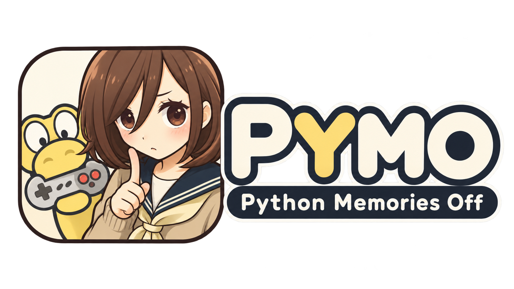

<p align="center">
  
</p>

# CPyMO for Nintendo DS

**在 Nintendo DS、DS Lite 和 DSi 上体验 PyMO 视觉小说。**

CPyMO for NDS 是基于 [CPyMO](https://github.com/Strrationalism/CPyMO)
的 NDS 移植版本。一个 `.nds` 可从游戏资料库启动多款 PyMO 游戏。
配套转换助手支持 S60v3、S60v5 和 Android 版 PyMO 游戏数据。

**最新版本** [CPyMO for NDS 1.4.0](https://github.com/Blueteemo/CPyMO/releases/tag/nds-v1.4.0)

## 下载与开始使用

> 发行页汇总通用 NDS 程序、Windows 和 macOS ARM64 Starter、完整源码及 SHA-256 校验清单。

| 用途 | 发行文件 |
|---|---|
| 已转换过游戏，只更新引擎 | [cpymo-nds.nds](https://github.com/Blueteemo/CPyMO/releases/download/nds-v1.4.0/cpymo-nds.nds) |
| 首次使用、转换游戏、添加视频 | [Windows Starter](https://github.com/Blueteemo/CPyMO/releases/download/nds-v1.4.0/CPyMO-for-NDS-1.4.0-Starter-Windows.zip) / [macOS ARM64 Starter（Apple Silicon）](https://github.com/Blueteemo/CPyMO/releases/download/nds-v1.4.0/CPyMO-for-NDS-1.4.0-Starter-macOS-arm64.zip) |
| 查看全部变更与校验 | [发行说明](https://github.com/Blueteemo/CPyMO/releases/tag/nds-v1.4.0) · [完整对应源码](https://github.com/Blueteemo/CPyMO/releases/download/nds-v1.4.0/CPyMO-for-NDS-1.4.0-Sources.zip) · [SHA256SUMS](https://github.com/Blueteemo/CPyMO/releases/download/nds-v1.4.0/CPyMO-for-NDS-1.4.0-SHA256SUMS.txt) |

**其他平台**　Symbian S60v3 和初代 RG35XX（GarlicOS）的客户端请前往 [CPyMO Ports](https://github.com/Blueteemo/CPyMO-Ports)。

转换助手在电脑上运行，游戏程序在 DS / DSi 上运行。**发行包不附任何游戏或用户存档。**

## 1.4.0 更新

- **完善存读档预览。** 每屏显示三个档位，两档字号均可查看章节、最多两行对白预览和存档时间。
- **优化界面与交互。** 调整启动画面、游戏列表、游戏内菜单、确认提示和正文继续光标。
- **同步更新桌面转换助手。** Windows 和 macOS ARM64 Starter 均内置 1.4.0 引擎，转换结果也会附带新版 `cpymo-nds.nds`。

完整变化见 [1.4.0 发行说明](https://github.com/Blueteemo/CPyMO/releases/tag/nds-v1.4.0)。

## 安装

1. 在 Windows 或 Apple Silicon macOS 转换助手中选择自己的 PyMO 游戏 ZIP 或包含 `gameconfig.txt` 的游戏文件夹，使用推荐默认选项转换。
2. 将转换结果的 `cpymo-nds.nds` 和 `pymo/` 文件夹复制到 TF 卡根目录。
3. 保留已有烧录卡内核、游戏和存档。安装同名游戏前先备份 `save/`，**不要用新转换结果的空存档目录覆盖旧存档**。
4. 在掌机启动 `cpymo-nds.nds`，从游戏列表选择游戏。

```text
TF 卡根目录/
├── cpymo-nds.nds
└── pymo/
    └── games/
        └── 游戏目录/
            ├── gameconfig.txt
            ├── script/
            ├── nds-cache/
            └── save/
```

从 1.3.0 升级时，已转换且能正常运行的游戏通常只需替换 `cpymo-nds.nds`，保留原有游戏目录和存档。如需为旧游戏添加视频，应从合法持有的原游戏数据转换到新目录，并保留旧存档。

## 操作

| 输入 | 作用 |
|---|---|
| A、轻触 | 确认、继续；游戏库轻触两次可启动选中游戏 |
| X | 游戏正文打开引擎菜单；游戏列表中可切换界面语言 |
| B | 返回／取消；视频播放时跳过 |
| L | 上屏游戏 → 下屏游戏 → 增强双屏 |
| Y | 游戏中隐藏或唤回辅助屏；资料库打开主题设置 |
| R | 根据游戏设置快进 |
| START | 资料库启动选中游戏；游戏正文快速保存到标准存档 1，会覆盖该存档 |
| SELECT | 游戏正文快速读取标准存档 1；资料库刷新列表 |
| 合盖 / 开盖 | 暂停与静音／恢复 |

## 兼容性、转换器和开发文档

- [NDS 后端、安装与兼容边界](https://github.com/Blueteemo/CPyMO/blob/nds-v1.4.0/cpymo-backends/nds/README.md)
- [转换助手使用说明、命令行与视频编码](https://github.com/Blueteemo/CPyMO/blob/nds-v1.4.0/cpymo-tool/nds-converter/README.md)
- [正式发行说明与已知限制](https://github.com/Blueteemo/CPyMO/releases/tag/nds-v1.4.0)
- [旧版下载](https://github.com/Blueteemo/CPyMO/releases)

Mac ARM64 包采用临时签名，未经 Apple Developer ID 签名及 Apple 公证。

转换器支持 Android PyMO 游戏数据，**不直接接受 APK 安装包**。视频默认转换为 NVL1，可选 NVA1 或跳过视频。
转换器不会修改原游戏包、原脚本或汉化署名；缺字默认显示方框并记录警告。
部分打包／加密脚本、特殊片源及个别烧录卡配置可能需要额外处理。

## 源码、作者与许可证

**NDS 平台移植：千岚之夏。**

本移植基于 [Strrationalism/CPyMO](https://github.com/Strrationalism/CPyMO)
（Seng Jik 及贡献者），其基础引擎来自
[PyMO](https://github.com/pymo/pymo)（chen_xin_ming 及贡献者）。
引擎和转换助手的 1.4.0 发行源码见 [`nds-v1.4.0` 标签](https://github.com/Blueteemo/CPyMO/tree/nds-v1.4.0)。含构建所需子模块的完整源码和附件校验值见 [发行页](https://github.com/Blueteemo/CPyMO/releases/tag/nds-v1.4.0)。

CPyMO 引擎及 NDS 后端按 AGPL-3.0-or-later 发行，
独立转换器按 MIT 许可发行。第三方字库、FFmpeg 与其他依赖保留原授权和归属，
详见对应源码及发行包的许可声明。本项目仅用于用户合法持有的游戏资料。
