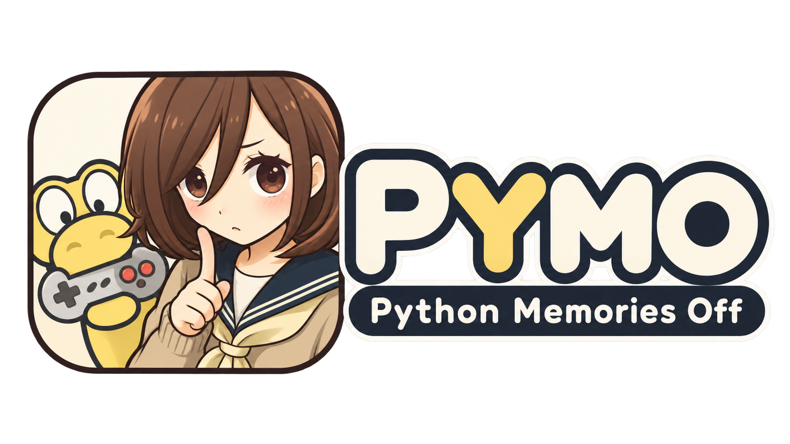

<!-- Root README replacement draft, NOT yet the repository root README.
Publish to Blueteemo/CPyMO:main only after the 1.2.0 assets and Release exist.
Preview path is relative to this draft: ../../assets/branding/pymo-long-logo.webp.\nExpected image path when copied to the final ROOT README: assets/branding/pymo-long-logo.webp.\nOnly the user-selected second long logo has been committed. When promoting\nthe draft to root README, remove the leading ../../ from the image path.\nKeep upstream PR #60's source branch separate; update PR #60 description AFTER
formal release with accurate links and accepted feature summary. -->

<p align="center">
  
</p>

# CPyMO for Nintendo DS

**在 Nintendo DS / DS Lite / DSi 上体验 PyMO 视觉小说。**

CPyMO for NDS 是基于 [CPyMO](https://github.com/Strrationalism/CPyMO)
的 Nintendo DS 系列移植版本。一个 `.nds` 可从游戏资料库启动多个 PyMO 游戏；
配套转换助手支持 S60v3、S60v5 与 Android PyMO 游戏数据。

**最新版本：1.2.0**（正式发布后再将本行改为对应 Release 下载入口）

## 下载与开始使用

> 正式发布后指向 [CPyMO for NDS 1.2.0](https://github.com/Blueteemo/CPyMO/releases/tag/nds-v1.2.0) 的实际发行附件；发布前不要将尚不存在的附件链接放到主分支。

| 用途 | 发行文件 |
|---|---|
| 已转换过游戏，只更新引擎 | `cpymo-nds.nds` |
| 首次使用、转换游戏、添加视频 | Windows Starter；Apple Silicon Mac 使用通过最终验收的 ARM64 版，不提供 Intel macOS 预编译附件 |
| 查看全部变更与校验 | 1.2.0 Release Notes、Sources、SHA256SUMS |

转换助手在电脑上运行，游戏程序在 DS / DSi 上运行。**本仓库不附任何商业游戏。**

## 1.2.0 新增了什么

- **DSi/TWL 原生运行**：可根据实际模式使用条件式更大资源缓存；同时保持传统 DS 模式兼容。
- **增强双屏**：L 键在上屏游戏、下屏游戏和增强双屏之间轮换。上屏保留场景，下屏呈现对白和交互；星夜背景内置 ROM。
- **游戏视频**：转换助手默认将可识别视频转为 NVL1，也可选 NVA1 或跳过；播放后恢复游戏。
- **多游戏资料库**：方向键连续滚动、超过四项出现触控滚动条；在合适的 DSi 启动环境中可发现可访问的另一张存储卡。
- **更贴近掌机操作**：菜单内退出到游戏库、触控交互、存读档提示与多语言显示完善。

更详细的与 1.1 差异见 [1.2.0 发行说明](https://github.com/Blueteemo/CPyMO/releases/tag/nds-v1.2.0)。

## 安装

1. 在 Windows 或 Apple Silicon macOS 转换助手中选择自己的 PyMO 游戏 ZIP 或游戏文件夹，使用推荐默认选项转换。
2. 将转换结果的 `cpymo-nds.nds` 和 `pymo/` 文件夹复制到 TF 卡根目录。
3. 保留已有烧录卡内核、游戏和存档。覆盖同名游戏目录前，**先备份 `save/`**。
4. 在掌机启动 `cpymo-nds.nds`，从游戏列表选择游戏。

```text
TF 卡根目录/
├── cpymo-nds.nds
└── pymo/
    └── games/
        └── 游戏目录/
            ├── gameconfig.txt
            ├── script/
            ├── nds-cache/
            └── save/
```

已有 1.1 数据通常只需要更新 `.nds`；如需为旧游戏新加入视频，应使用 1.2 转换助手从合法持有的原游戏数据生成对应视频缓存，并保留旧存档。

## 操作

| 输入 | 作用 |
|---|---|
| A、DOWN、轻触 | 对白继续／操作当前界面 |
| X | 游戏内菜单；游戏列表中可切换界面语言 |
| B | 返回／取消；视频播放时跳过 |
| L | 上屏游戏 → 下屏游戏 → 增强双屏 |
| Y | 隐藏或唤回辅助屏 |
| R | 根据游戏设置快进 |
| START / SELECT | 快速保存／快速读取标准存档 1 |
| 合盖 / 开盖 | 暂停与静音／恢复 |

## 画面展示

<!-- 正式发行时放置来源明确的真实 NTR/TWL 游戏库、经典和增强双屏截图。
不放合成截图、借用的游戏商业素材或未经确认的模拟器画面。 -->

## 兼容性、转换器和开发文档

- [NDS 后端、安装与兼容边界](cpymo-backends/nds/README.md)
- [转换助手：简体中文 / English GUI、命令行、视频编码](cpymo-tool/nds-converter/README.md)
- [正式发行说明与已知限制](https://github.com/Blueteemo/CPyMO/releases/tag/nds-v1.2.0)
- [旧版下载](https://github.com/Blueteemo/CPyMO/releases)

转换器不会修改原游戏包、原脚本或汉化署名；缺字默认显示方框并记录警告。
部分打包／加密脚本、特殊片源及个别烧录卡配置可能需要额外处理。

## 源码、作者与许可证

**NDS 平台移植：千岚之夏。**

本移植基于 [Strrationalism/CPyMO](https://github.com/Strrationalism/CPyMO)
（Seng Jik 及贡献者），其基础引擎来自
[PyMO](https://github.com/pymo/pymo)（chen_xin_ming 及贡献者）。
本仓库保留其他原有平台的源码，但此 Fork 的下载与使用说明以 Nintendo DS 版本为中心；
其他平台的维护与说明请参考原上游仓库。

CPyMO 引擎及 NDS 后端按 AGPL-3.0-or-later 发行，
独立转换器按 MIT 许可发行。第三方字库、FFmpeg 与其他依赖保留原授权和归属，
详见对应源码及发行包的许可声明。本项目仅用于用户合法持有的游戏资料。
